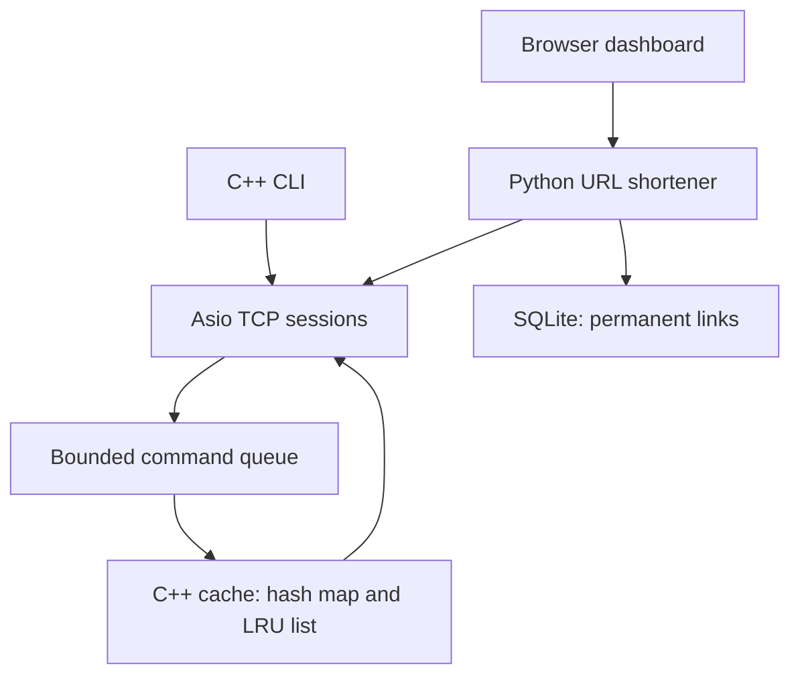

# VoltCache

A small C++ cache server, with a CLI and a working URL shortener.

VoltCache stores temporary copies of data that another application might need again. The URL shortener makes that visible: the first lookup reads SQLite, and the next can use VoltCache. Stop the cache and the same link still works, because SQLite keeps the original.

The dashboard uses real requests and statistics. It has a responsive layout, an animated cache stack, and a request path that changes when a lookup hits the cache or reaches SQLite. Motion respects your device's reduced-motion preference.

## Start here

You need a C++17 compiler, CMake 3.20 or newer, and Python 3.10 or newer. Asio's headers are included. The Python app uses the standard library; there is no npm or pip install for the app.

On macOS, install the compiler tools if needed:

```sh
xcode-select --install
brew install cmake python
```

From the extracted `VoltCache` folder:

```sh
python3 tools/run.py
```

Open **http://127.0.0.1:8080**. Ctrl+C stops both services. Your links remain in `demo/data/links.sqlite3`.

If a port is busy:

```sh
python3 tools/run.py --port 8081 --cache-port 6380
```

Linux was built and tested during development. A GitHub Actions workflow is included for Linux and macOS; that is not a claim that this copy has already been tested on your Mac. Windows is not a supported target of the current launcher and tests.

## Try the whole system in two minutes

1. Create a link to `https://example.com` with the custom code `example`.
2. Click **Resolve**. The app reads SQLite and puts a temporary copy in VoltCache.
3. Click **Resolve** again. Before expiration, the destination comes from VoltCache.
4. Open the short link. The HTTP app returns a `302` redirect.
5. Wait 60 seconds after cache population and resolve again. The expired copy is missing, so SQLite is read again.

For a faster expiration demo, start with `python3 tools/run.py --ttl 5`.

For a cache failure demonstration, run the services separately as shown below. Stop only the cache, then resolve a saved link. The dashboard shows **SQLite fallback** and the link still resolves. Restart VoltCache and the cache fills again on demand.

## Build and run separately

```sh
cmake -S . -B build -DCMAKE_BUILD_TYPE=Release
cmake --build build --parallel 2
ctest --test-dir build --output-on-failure
```

Terminal 1 — cache:

```sh
./build/voltcache-server --port 6379 --max-entries 10000
```

Terminal 2 — demo:

```sh
python3 demo/app.py
```

Terminal 3 — CLI:

```sh
./build/voltcache-cli
```

```text
volt> SET name "Nomaan Munshi"
OK
volt> GET name
"Nomaan Munshi"
volt> SET weather:trento "8 degrees" EX 300
OK
volt> TTL weather:trento
299
volt> DEL name
1
volt> GET name
NOT_FOUND
volt> QUIT
```

The TTL value depends on when the command runs. The CLI also accepts a command directly:

```sh
./build/voltcache-cli SET greeting "hello world"
./build/voltcache-cli GET greeting
./build/voltcache-cli STATS
```

`--host`, `--port`, and `--timeout-ms` must come before the command. Host options accept numeric IP addresses. The interactive parser accepts single or double quotes, empty quoted values, and `\n`, `\r`, `\t`, or escaped characters. It does not run shell commands. The wire protocol also supports binary keys and values, including null bytes.

## What is implemented

| Feature                | Behavior                                                                                                 |
| ---------------------- | -------------------------------------------------------------------------------------------------------- |
| Cache engine           | String or binary values indexed by a hash map                                                            |
| LRU                    | A doubly linked list tracks recency; reads and writes move an entry to the front                         |
| Expiration             | Steady-clock deadlines, checks on access, periodic cleanup                                               |
| Atomic expiring writes | `SET key value EX seconds` sets both value and TTL in one command                                        |
| Capacity               | Maximum entry count; expired entries are reclaimed before evicting a live entry                          |
| Networking             | Asio asynchronous TCP, length-prefixed frames, partial reads and pipelined requests                      |
| Concurrency            | One event loop owns the cache and command queue; many client connections can be active                   |
| Limits                 | Bounded command queue, frame/key/value limits, connection limit, complete-frame read and write deadlines |
| Statistics             | Hits, misses, evictions, expiry removal, connections, commands, queue occupancy and rejection counters   |
| CLI                    | Interactive prompt and one-command mode; explicit error exit status                                      |
| URL shortener          | Immutable links in SQLite, cache-aside resolution, cache failure fallback                                |
| Dashboard              | Create, copy, inspect and open links; real counters and request feedback                                 |
| Verification           | Unit checks, process-level integration tests, sanitizer build option, benchmark runner                   |

## Command rules

| Command                    | Reply                         | Details                                                 |
| -------------------------- | ----------------------------- | ------------------------------------------------------- |
| `PING`                     | `PONG`                        | Liveness check                                          |
| `SET key value`            | `OK`                          | Create or overwrite; clears any previous expiration     |
| `SET key value EX seconds` | `OK`                          | Atomic value and TTL; TTL is 1–31,536,000 seconds       |
| `GET key`                  | `VALUE`, value or `NOT_FOUND` | Only this command changes hit/miss counts               |
| `DEL key`                  | `INT`, `1` or `0`             | Expired entries count as absent                         |
| `EXISTS key`               | `INT`, `1` or `0`             | Does not refresh recency                                |
| `EXPIRE key seconds`       | `INT`, `1` or `0`             | Zero deletes immediately; negative values are invalid   |
| `TTL key`                  | `INT`, seconds                | Rounds down; `-1` means no expiry and `-2` means absent |
| `STATS`                    | `STATS`, key/value pairs      | Reclaims expired entries before reporting size          |

Command names are ASCII case-insensitive. Keys are 1–256 bytes, values are at most 60,000 bytes, and frame payloads are at most 65,536 bytes. Empty values are allowed. A malformed frame gets an error before the server closes that connection. An invalid command gets an error and the connection remains usable. Replies on one connection follow request order.

The protocol is deliberately small and **is not Redis RESP-compatible**. See [the protocol reference](docs/protocol.md) to write another client.

## Architecture



The server runs `io_context::run()` on one thread. Socket work is asynchronous, but cache commands execute serially. That removes cache locking and makes command ordering clear. The application queue is bounded, and each connection can have at most one command waiting there. The operating system can buffer further incoming bytes; the application does not allocate an unbounded pipeline per client.

A normal cache lookup and LRU update take average O(1) time, excluding copying the key/value. A full expiration sweep takes O(n); inserting at capacity also sweeps to avoid evicting a live entry while expired ones occupy space. Large caches can therefore cause event-loop pauses. This tradeoff is intentional and documented rather than hidden behind an O(1) claim for every operation.

The demo opens a cache connection for each resolution and uses that connection for lookup and population. The interactive CLI opens a connection per command so an idle prompt does not occupy a server slot. The benchmark reuses its connections. That difference matters when interpreting performance. Concurrent cache misses may read the same SQLite row more than once; there is no request coalescing.

More detail: [architecture and limits](docs/architecture.md).

## Tests

```sh
ctest --test-dir build --output-on-failure
```

The C++ unit checks use an injected time point, so expiration boundaries can be checked without sleeping. The integration suite starts real processes on dynamically assigned ports and uses a temporary SQLite database.

It checks binary values, fragmented frames, pipelining, oversized and malformed messages, large values, recency, expiration, simultaneous clients, overload, idle timeouts, connection limits, CLI behavior, shutdown, HTTP validation, redirects, cache failure, and persistence across app restart.

For memory and undefined-behavior checks with GCC or Clang:

```sh
cmake -S . -B build-sanitize -DCMAKE_BUILD_TYPE=Debug -DVOLTCACHE_SANITIZERS=ON
cmake --build build-sanitize --parallel 2
ctest --test-dir build-sanitize --output-on-failure
```

Some restricted environments cannot run LeakSanitizer. In that situation `ASAN_OPTIONS=detect_leaks=0 ctest --test-dir build-sanitize --output-on-failure` still checks address errors and undefined behavior, but **does not check for leaks**.

Optional browser checks exercise creation, cache hits, database fallback, counters, responsive layouts, and reduced motion. These development checks require Node.js and Playwright; the app itself does not:

```sh
npm install --no-save --package-lock=false playwright
npx playwright install chromium
node tests/browser.cjs
```

## Measure it yourself

Start a release-build server, then run:

```sh
python3 tools/benchmark.py --clients 4 --requests 5000 --keys 100 \
  --value-size 128 --hit-ratio 0.8 --output benchmark-results/local.json
```

`--requests` is per client. The runner preloads its own namespaced keys, opens persistent connections, measures sequential GET round trips, and removes its keys afterward. It reports successes, errors, actual hit/miss counts, throughput, p50/p95/p99 latency, workload, environment, and before/after server statistics. Run it against a disposable server: preloading can evict other entries.

A short development run completed 8,000 GETs across four clients with 128-byte values and zero errors. Its raw output is in [benchmark-sample.json](docs/benchmark-sample.json). This is a local measurement, not a production capacity claim. Python client overhead, host load, and loopback networking affect it. It is not a Redis comparison. A local SQLite read may be faster than a TCP lookup; this project does not pretend otherwise.

## Server options

| Option             | Default     | Range / meaning                                                     |
| ------------------ | ----------- | ------------------------------------------------------------------- |
| `--host`           | `127.0.0.1` | Numeric IP bind address                                             |
| `--port`           | `6379`      | 0–65,535; zero requests a free port                                 |
| `--max-entries`    | `10000`     | 1–1,000,000                                                         |
| `--queue-capacity` | `1024`      | 1–65,536 pending commands                                           |
| `--max-clients`    | `256`       | 1–4,096                                                             |
| `--timeout-ms`     | `10000`     | 10–3,600,000; incoming complete-frame or outgoing response deadline |
| `--cleanup-ms`     | `1000`      | 10–3,600,000; periodic full sweep                                   |

At connection capacity, a new socket is closed. At command-queue capacity, the response is `ERROR BUSY`; that rejected command is not executed. Defaults allow fewer clients than queue slots, so queue overload is normally prevented by the connection limit first. Set a smaller queue if you want to demonstrate BUSY behavior.

## Repository guide

```text
include/voltcache/  Cache, protocol, command, and queue interfaces
src/               Cache engine, protocol, commands, server, and CLI
tests/             C++ unit checks and Python integration tests
demo/              Python client, HTTP app, and static dashboard
tools/             Local launcher and benchmark
docs/              Protocol, architecture, and measured sample
third_party/asio/  Pinned Asio headers and upstream license
```

Start reading `src/cache.cpp`, then `src/commands.cpp`, then `src/server.cpp`. The HTTP app is intentionally Python so that the C++ cache remains the main engineering project. The frontend uses HTML, CSS, and JavaScript; it does not need a frontend framework or build step.

## Boundaries

This is a complete implementation of the scoped local demonstration, not a production Redis replacement. There is no authentication, TLS, cache persistence, replication, cluster routing, or automatic failover. Keep it on loopback. The URL shortener is a local demo and is not ready for public hosting without user access controls, abuse prevention, and operational work.

Entry count is not a RAM budget. At the maximum value size, even the default 10,000-entry limit could represent about 600 MB of value bytes, plus keys, containers, connections, and allocator overhead. Configure limits for your machine.

The dashboard's demo counters reset when the Python app restarts. Server counters reset when VoltCache restarts. The cache hit rate excludes failed cache operations; cache entry counts include keys from the CLI and other clients too. Statistics polling itself adds `STATS` commands.

MIT license for the project. Asio retains its Boost Software License in `third_party/asio/LICENSE`.
